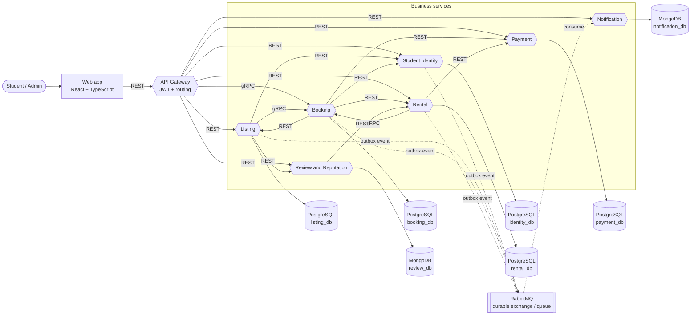
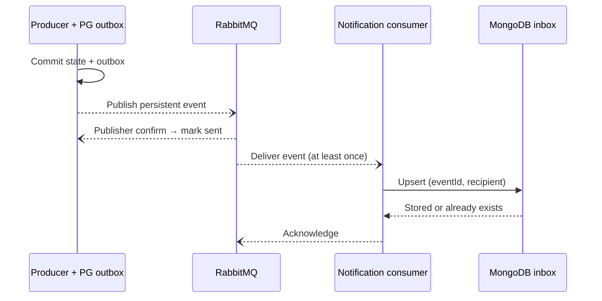

# Services

CampusKit has seven business services behind one API Gateway. Each service owns a separate logical database and credentials. The gateway validates and propagates JWTs and routes REST and gRPC requests; it contains no business logic. The data-owning service enforces role, ownership, and participation (see `docs/adr/adr-002-authenticate-centrally-authorise-at-data-owner.md`). Scheduled operations are background jobs inside the owning service.

The React + TypeScript web app serves both students and administrators and calls only the gateway, over REST.

## External systems

All production integrations are deferred. The demo substitutes a local component for each.

| External system | Demo substitute |
|---|---|
| Payment Gateway | Local ledger adapter inside Payment, with no real money. Provider selection is deferred (see `docs/adr/adr-006-isolate-payment-integration-behind-adapter.md`). |
| University Identity Provider | Email verification code (shown on the UI in demo mode) plus administrator review of student status. |
| Email & Push Providers | MongoDB in-app inbox in Notification, filled from RabbitMQ events. |
| Object Storage (S3) | Compressed inline data URLs for photographs. Signed upload and download URLs are a future integration. |

## Service catalogue

Operation labels describe responsibilities, not exact endpoint names.

| Service | Responsibility | Current operations | Collaborators and delivery | Protocol | Database |
|---|---|---|---|---|---|
| **Student Identity** | Authentication, verification, eligibility | Register and log in; verify email; administrator student verification; check eligibility and profile | Gateway validates and propagates the JWT. Other services query eligibility and profile. Writes notification outbox events. | REST | PostgreSQL `identity_db` |
| **Listing** | Items, pricing, screening | Create a safe DRAFT; search, detail, quote; moderation; publish and unpublish | Identity: eligibility and payout profile. Booking: calendar setup and availability (gRPC). Review: reputation summary. Outbox events. | REST; gRPC client | PostgreSQL `listing_db` |
| **Booking** | Authoritative calendar and agreed terms | Set calendar; check availability; request, approve, cancel booking; scheduled expiry and compensation | Identity: eligibility. Listing: detail and quote. Payment: authorize and void. Rental: create and cancel. Outbox events. | gRPC server; REST client | PostgreSQL `booking_db` |
| **Rental** | Custody and settlement workflow | Pickup and return evidence and codes; confirm pickup and return; settlement and retry; scheduled overdue checks and reminders | Booking: status, calendar release, affected bookings (gRPC). Payment: capture and settle. Outbox events. Closes after successful settlement. | REST; gRPC client | PostgreSQL `rental_db` |
| **Payment** | Demo ledger and payment adapter | Payment method; fee and deposit authorization; capture; void and refund; late-fee settlement; payout | Local ledger adapter; no real provider calls. Stable financial operation IDs prevent duplicates. Booking and Rental publish the related notifications. | REST | PostgreSQL `payment_db` |
| **Review and Reputation** | Participant reviews | Submit review; read reputation summary | Rental: verify CLOSED status and participation before accepting a review. No review notification event in the current scope. | REST | MongoDB `review_db` |
| **Notification** | Event delivery and inbox | Consume events; upsert and list inbox; reconnect after broker failure | RabbitMQ durable queue → MongoDB inbox. Acknowledge after storage; deduplicate on (`eventId`, `recipient`); dead-letter malformed events. | RabbitMQ consumer; REST inbox | MongoDB `notification_db` |

### Deferred capabilities

- Student Identity: account-restriction management, erasure, identity-document purge, and pseudonymisation remain proposed operations.
- Booking: calendar reconciliation is separate from the implemented request-expiry and compensation worker, and is deferred.
- Rental: settlement holds and dispute workflows are deferred.
- Payment: real-provider reconciliation is deferred.
- Notification: external contacts and delivery retry are deferred.
- Damage and loss claims and dispute adjudication have no service or database in this iteration.

### Database choice

PostgreSQL supports transactional reservations, custody, and financial records; Booking also needs range and exclusion constraints. MongoDB stores each review or inbox entry as a document and supports compound unique indexes for business-level deduplication. This is a suitable course choice, not a claim that relational storage could not handle these records. Two database technologies add index, credential, backup, and recovery work. Shared local instances reduce setup cost but remain infrastructure failure points (see `docs/adr/adr-004-database-per-service.md`).

Seven services demonstrate independent ownership and deployment; for a five-person team they also increase contract-testing and recovery work. One shared Compose configuration and a reduced feature scope keep that cost manageable (see `docs/adr/adr-001-decompose-by-business-capability.md`).

## Container view (C4 level 2)

Solid edges are synchronous calls. Dashed edges are asynchronous events.



## Sequences

Protected requests carry JWTs; the data-owning service checks role, ownership, or participation. The event path is the asynchronous path below, not a synchronous Notification call.

### Publish an equipment listing

```mermaid
sequenceDiagram
  participant O as Owner via Gateway
  participant L as Listing (REST)
  participant I as Identity (REST)
  participant B as Booking (gRPC)
  participant E as Event / inbox path
  O->>L: Submit listing (JWT)
  L->>I: Check eligibility / payout profile
  L->>L: Validate; save DRAFT
  L->>B: Set up calendar
  B-->>L: Calendar setup succeeds
  L->>L: Publish, or pending review
  L--)E: Domain state + outbox; publish after commit
```

Moderated listings publish after approval; invalid input is rejected. Calendar failure keeps the listing unpublished. Broker failure delays the inbox.

### Book and pay for a rental

```mermaid
sequenceDiagram
  participant P as Parties via Gateway
  participant B as Booking (gRPC)
  participant Pay as Payment (REST)
  participant R as Rental (REST)
  participant E as Event / inbox path
  P->>B: Request booking (JWT)
  B->>B: Eligibility / quote checks (Identity, Listing via REST)
  B->>B: Atomic reservation; PENDING
  P->>B: Owner approves
  B->>Pay: Authorize fee + deposit
  Pay-->>B: Authorization result
  B->>R: Create rental (idempotent)
  R-->>B: Rental created
  B--)E: CONFIRMED + outbox → notification
```

Failed authorization: retry within the window; expiry releases the dates and voids holds. Failed confirmation: compensate payment and reservation; track unresolved recovery.

### Handover, return, and settlement

```mermaid
sequenceDiagram
  participant P as Parties via Gateway
  participant R as Rental (REST)
  participant B as Booking (gRPC)
  participant Pay as Payment (REST)
  participant Rv as Review (REST)
  P->>R: Pickup evidence + renter confirms owner code
  R->>B: Recheck booking
  R->>Pay: Capture fee (deposit stays reserved)
  Pay-->>R: Capture succeeds; record ACTIVE
  P->>R: Return evidence + owner accepts renter code
  R->>R: SETTLEMENT_PENDING
  R->>B: Release calendar
  R->>Pay: Settle late fee, deposit, payout
  Pay-->>R: Settlement succeeds; CLOSED
  P->>Rv: Submit participant review
  Rv->>R: Check CLOSED + participant
```

Rental commits also write outbox events. Settlement failure keeps custody and `SETTLEMENT_PENDING` for explicit retry.

### Asynchronous notification delivery



Identity, Listing, Booking, and Rental produce events. Duplicate delivery does not create a second inbox record. Malformed events go to a dead-letter queue; transient storage failures are requeued. Broker outages delay the inbox without reversing committed business state. Review and Payment publish no notification events in the current scope (see `docs/adr/adr-008-rabbitmq-events-with-transactional-outbox.md`).

## Service discovery and local deployment

Docker Compose DNS resolves service names inside the Compose network. Services read endpoint addresses from environment configuration instead of hard-coding container IPs. The gateway translates client REST requests to Booking gRPC where needed; Listing and Rental also call Booking through gRPC.

| Service | Address | Protocol | Code |
|---|---|---|---|
| API Gateway | `gateway:3000` | REST (public) | `apps/gateway` |
| Student Identity | `identity:3001` | REST | `apps/identity` |
| Listing | `listing:3002` | REST | `apps/listing` |
| Booking | `booking:50051` | gRPC (HTTP `booking:3007` serves only health and docs) | `apps/booking` |
| Rental | `rental:3003` | REST | `apps/rental` |
| Payment | `payment:3004` | REST | `apps/payment` |
| Review and Reputation | `review:3005` | REST | `apps/review` |
| Notification | `notification:3006` | REST inbox; RabbitMQ consumer | `apps/notification` |

The local deployment uses one PostgreSQL instance and one MongoDB instance with separate logical databases and credentials per service, plus persistent volumes. There is no external service registry and no multi-instance gRPC balancing. Volumes alone do not prove backup and restore targets; RPO/RTO, TLS, and load and usability testing remain acceptance or production targets (see `docs/requirements.md`).

## Collaboration checks

These are a validation plan, not claimed test results.

- Listing publication: validate before saving a DRAFT; calendar setup must succeed before publication.
- Booking: prevent overlapping committed reservations; retry authorization within its window and compensate for a failed confirmation.
- Handover and settlement: keep the deposit after fee capture; accept evidence and code at return, release the calendar, settle, then close.
- Review requires a CLOSED rental and participant authorization.
- Verify broker outage and recovery and duplicate event delivery separately from payment-workflow recovery.

## Open questions

- **Internal service authentication is not specified.** `docs/adr/adr-002-authenticate-centrally-authorise-at-data-owner.md` requires internal service credentials for service-to-service calls but does not choose a mechanism.
