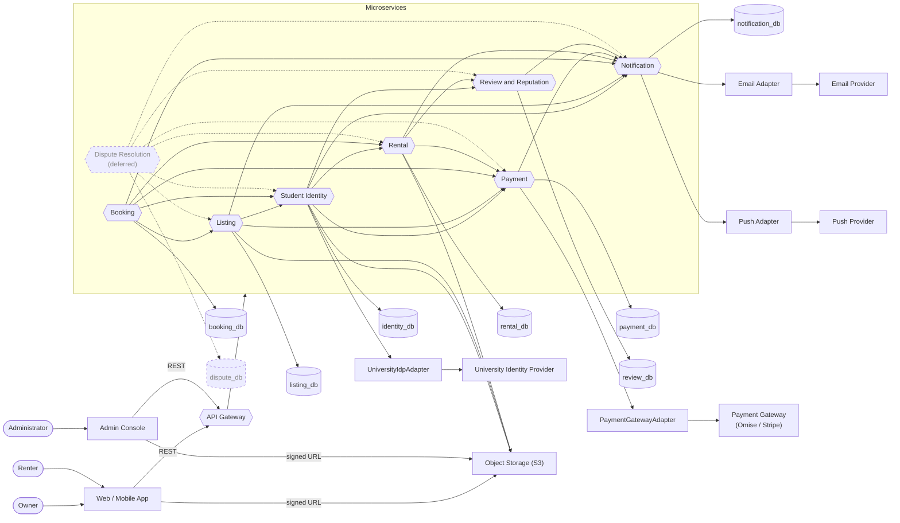

# Services

CampusKit is split into domain microservices behind an API Gateway. The API Gateway routes requests but contains no business logic. Clients call the API Gateway over REST: the Web / Mobile App is used by the Owner and the Renter, and the Admin Console is used by the Administrator. Clients upload and download files directly to and from Object Storage using short-lived signed URLs minted by the services, so zero bytes flow through the microservices.

## External systems

| External system | Reached via |
|---|---|
| Payment Gateway (Omise / Stripe) | PaymentGatewayAdapter, used by the Payment Service |
| University Identity Provider | UniversityIdpAdapter, used by the Student Identity Service |
| Email & Push Providers | Adapters in the Notification Service (an Email Adapter and a Push Adapter) |
| Object Storage (S3) | Clients directly, via short-lived signed URLs minted by services |

## Service catalogue

This table maps every system operation to the service that owns its business capability, so that logic resides in the proper domain. "(scheduled)" marks a time-triggered background job.

| Service | Responsibility | Private DB | Key operations | Collaborators (calls made) |
|---|---|---|---|---|
| **Student Identity Service** | Owns verification, account standing, and eligibility. | `identity_db` | `verifyStudentIdentity()` `checkRentalEligibility()` `applyAccountRestriction()` `requestErasure()` `purgeExpiredIdentityDocuments()` (scheduled) | **Rental / Payment / Review:** `pseudonymiseParty()` **Notification:** `sendNotification()` **External:** IdP, Object Storage |
| **Listing Service** | Owns items, prices, condition evidence specs, and screening. | `listing_db` | `createListing()` `searchListings()` `quoteBooking()` `moderateListing()` | **Student Identity:** `checkRentalEligibility()` **Payment:** `getPayoutDestinationStatus()` **Notification:** `sendNotification()` **External:** Object Storage |
| **Booking Service** | Owns availability calendar and commercial agreements. | `booking_db` | `findAvailableListings()` `requestBooking()` `approveBooking()` `cancelBooking()` `expireStaleRequests()` (scheduled) `reconcileCalendar()` (scheduled) | **Listing:** `getListingDetail()`, `quoteBooking()` **Payment:** `authorizeRentalPayment()`, `voidAuthorization()` **Rental:** `createRental()`, `cancelRental()` **Identity / Notification** |
| **Rental Service** | Owns custody, handovers, overdue states, and settlement orchestration. | `rental_db` | `createRental()` `issueHandoverCode()` `confirmPickup()` `confirmReturn()` `submitConditionReport()` `holdSettlement()` `closeRental()` (scheduled) | **Payment:** `captureRentalFee()`, `settleDeposit()`, `payoutToOwner()` **Review:** `openReviewWindow()` **Notification / Object Storage** |
| **Payment Service** | Owns money movement and the internal ledger. | `payment_db` | `savePaymentMethod()` `authorizeRentalPayment()` `captureRentalFee()` `settleDeposit()` `payoutToOwner()` `reconcileLedger()` (scheduled) | **External:** Payment Gateway (Authorize, Capture, Void, Transfer) **Notification** |
| **Review and Reputation Service** | Owns two-sided reviews. | `review_db` | `submitReview()` `getReputationSummary()` `recordDisputeOutcome()` | **Notification:** `sendNotification()` |
| **Dispute Resolution Service** **Deferred — not built in this iteration** | Owns damage claims and adjudication. | `dispute_db` | `openDispute()` `submitEvidence()` `resolveDispute()` `enforceDisputeCompliance()` (scheduled) | **Rental:** `getRental()`, `holdSettlement()`, `closeRental()` **Identity:** `applyAccountRestriction()` **Payment / Review / Listing / Notification** |
| **Notification Service** | Owns message delivery. | `notification_db` | `sendNotification()` `upsertNotificationContact()` `retryFailedDeliveries()` (scheduled) | **External:** Email Provider, Push Provider |

The Dispute Resolution Service stays in the catalogue but is deferred, consistent with the proposal, which defers dispute adjudication and damage/loss claims (see `docs/adr/adr-001-decompose-by-business-capability.md`).

## Container view

This container view is derived from the Collaborators column of the service catalogue, not traced from the original diagram, whose internal edges were not legible enough to transcribe. Dashed nodes and edges belong to the deferred Dispute Resolution Service.

## Open questions

- **Inter-service protocols are not documented yet.** The submissions specify REST only between clients and the API Gateway; calls between services carry no protocol. The course has since taught gRPC and message brokers, and the term project must include REST, gRPC, message-broker and API-gateway components (see `docs/reference/course-syllabus.md`).
- **Student verification differs between submissions.** This catalogue uses a University IdP adapter and identity documents, while the proposal's verification flow uses an email code plus administrator review of student status (see `docs/reference/use-cases.md`).
- **Review and Reputation depends on a deferred service.** `recordDisputeOutcome()` depends on the deferred Dispute Resolution Service.
- **Privacy operations appear only here.** Student Identity's privacy operations (`requestErasure()`, `purgeExpiredIdentityDocuments()`, and the `pseudonymiseParty()` calls it makes to Rental, Payment and Review) appear only in this catalogue, not in the proposal.
- **Service count differs.** The proposal decomposes the system into seven services (see `docs/adr/adr-001-decompose-by-business-capability.md`); this catalogue lists eight because of Dispute Resolution.
- **Some called operations are not in the callee's operation list.** These are called in the Collaborators column but missing from the called service's Key operations: `getListingDetail()`, `getPayoutDestinationStatus()`, `voidAuthorization()`, `cancelRental()`, `getRental()`, `openReviewWindow()`, `pseudonymiseParty()`.
- **The payment provider is named here but deferred elsewhere.** This catalogue names Omise / Stripe, but provider selection is a deferred decision (see `docs/adr/adr-006-isolate-payment-integration-behind-adapter.md`).
- **Push Provider is not a proposal actor.** Notification uses a Push Provider, but the proposal lists only an Email Provider among the actors (see `docs/reference/project-context.md`).
- **`holdSettlement()` serves disputes, which are deferred.** Rental's `holdSettlement()` is called only by the deferred Dispute Resolution Service. Settlement is meant to have no dependency on a dispute service (see `docs/adr/adr-005-orchestrate-workflows-with-idempotent-recovery.md`).
