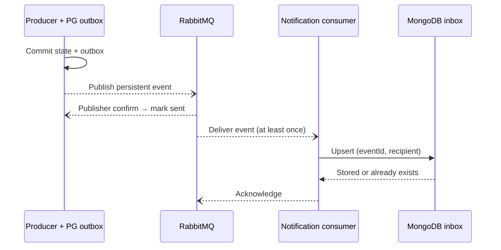

# Services

CampusKit has seven business services behind one API Gateway. Each service owns a separate logical database and credentials. The gateway validates and propagates JWTs and routes REST and gRPC requests; it contains no business logic. The data-owning service enforces role, ownership, and participation (see `docs/adr/adr-002-authenticate-centrally-authorise-at-data-owner.md`). Scheduled operations are background jobs inside the owning service.

The React + TypeScript web app serves both students and administrators and calls only the gateway, over REST.

## External systems

All production integrations are deferred. The demo substitutes a local component for each.

| External system | Demo substitute |
|---|---|
| Payment Gateway | Local ledger adapter inside Payment, with no real money. Provider selection is deferred (see `docs/adr/adr-006-isolate-payment-integration-behind-adapter.md`). |
| University Identity Provider | Email verification code (shown on the UI in demo mode) plus administrator review of student status. |
| Email & Push Providers | MongoDB in-app inbox in Notification, filled from RabbitMQ events. |
| Object Storage (S3) | Compressed inline data URLs for photographs. Signed upload and download URLs are a future integration. |

## Service catalogue

Operation labels describe responsibilities, not exact endpoint names.

| Service | Responsibility | Current operations | Collaborators and delivery | Protocol | Database |
|---|---|---|---|---|---|
| **Student Identity** | Authentication, verification, eligibility | Register and log in; verify email; administrator student verification; check eligibility and profile | Gateway validates and propagates the JWT. Other services query eligibility and profile. Writes notification outbox events. | REST | PostgreSQL `identity_db` |
| **Listing** | Items, pricing, screening | Create a DRAFT and publish it; search, detail, quote. Planned: moderation, unpublish | Identity: eligibility and profile. Booking: calendar setup (gRPC). Planned: Review reputation summary, outbox events. | REST; gRPC client | PostgreSQL `listing_db` |
| **Booking** | Authoritative calendar and agreed terms | Set calendar; check availability; request, approve, decline booking; release calendar; fail approvals that cannot complete and void their holds. Planned: cancel booking, scheduled request expiry | Identity: eligibility. Listing: quote. Payment: authorize and void. Rental: create. Outbox events. | gRPC server; REST client | PostgreSQL `booking_db` |
| **Rental** | Custody and settlement workflow | Pickup and return evidence and codes; confirm pickup and return; settlement and retry; scheduled overdue checks and reminders | Booking: status, calendar release, affected bookings (gRPC). Payment: capture and settle. Outbox events. Closes after successful settlement. | REST; gRPC client | PostgreSQL `rental_db` |
| **Payment** | Demo ledger and payment adapter | Payment method; fee and deposit authorization; capture; void and refund; late-fee settlement; payout | Local ledger adapter; no real provider calls. Stable financial operation IDs prevent duplicates. Booking and Rental publish the related notifications. | REST | PostgreSQL `payment_db` |
| **Review and Reputation** | Participant reviews | Submit review; read reputation summary | Rental: verify CLOSED status and participation before accepting a review. No review notification event in the current scope. | REST | MongoDB `review_db` |
| **Notification** | Event delivery and inbox | Consume events; upsert and list inbox; reconnect after broker failure | RabbitMQ durable queue → MongoDB inbox. Acknowledge after storage; deduplicate on (`eventId`, `recipient`); dead-letter malformed events. | RabbitMQ consumer; REST inbox | MongoDB `notification_db` |

### Deferred capabilities

- Student Identity: account-restriction management, erasure, identity-document purge, and pseudonymisation remain proposed operations.
- Booking: cancellation, a scheduled request-expiry worker (request expiry is lazy for now), and calendar reconciliation are deferred. The approval sweeper that fails started approvals and retries voids is implemented.
- Rental: settlement holds and dispute workflows are deferred.
- Payment: real-provider reconciliation is deferred.
- Notification: external contacts and delivery retry are deferred.
- Damage and loss claims and dispute adjudication have no service or database in this iteration.

### Database choice

PostgreSQL supports transactional reservations, custody, and financial records; Booking also needs range and exclusion constraints. MongoDB stores each review or inbox entry as a document and supports compound unique indexes for business-level deduplication. This is a suitable course choice, not a claim that relational storage could not handle these records. Two database technologies add index, credential, backup, and recovery work. Shared local instances reduce setup cost but remain infrastructure failure points (see `docs/adr/adr-004-database-per-service.md`).

Seven services demonstrate independent ownership and deployment; for a five-person team they also increase contract-testing and recovery work. One shared Compose configuration and a reduced feature scope keep that cost manageable (see `docs/adr/adr-001-decompose-by-business-capability.md`).

## Container view (C4 level 2)

Solid edges are synchronous calls. Dashed edges are asynchronous events.


## Sequences

Protected requests carry JWTs; the data-owning service checks role, ownership, or participation. The event path is the asynchronous path below, not a synchronous Notification call.

### Publish an equipment listing

```mermaid
sequenceDiagram
  participant O as Owner via Gateway
  participant L as Listing (REST)
  participant I as Identity (REST)
  participant B as Booking (gRPC)
  participant E as Event / inbox path
  O->>L: Submit listing (JWT)
  L->>I: Check eligibility / payout profile
  L->>L: Validate; save DRAFT
  L->>B: Set up calendar
  B-->>L: Calendar setup succeeds
  L->>L: Publish (moderation planned)
  L--)E: Outbox event (planned)
```

Invalid input is rejected before anything is saved. Calendar failure keeps the listing a DRAFT that the owner can publish again. Moderation and Listing's outbox events are planned, not built.

### Book and pay for a rental

```mermaid
sequenceDiagram
  participant P as Parties via Gateway
  participant B as Booking (gRPC)
  participant Pay as Payment (REST)
  participant R as Rental (REST)
  participant E as Event / inbox path
  P->>B: Request booking (JWT)
  B->>B: Eligibility / quote checks (Identity, Listing via REST)
  B->>B: Atomic reservation; PENDING
  P->>B: Owner approves
  B->>Pay: Authorize fee + deposit
  Pay-->>B: Authorization result
  B->>R: Create rental (idempotent)
  R-->>B: Rental created
  B--)E: CONFIRMED + outbox → notification
```

Unavailable Payment or Rental: the booking stays `AUTHORIZING` and the owner retries until the period starts. A refusal, or a period that starts first, makes the booking `FAILED`: the dates are released and Payment voids the holds (see Booking rules below).

### Handover, return, and settlement

```mermaid
sequenceDiagram
  participant P as Parties via Gateway
  participant R as Rental (REST)
  participant B as Booking (gRPC)
  participant Pay as Payment (REST)
  participant Rv as Review (REST)
  P->>R: Pickup evidence + renter confirms owner code
  R->>B: Recheck booking
  R->>Pay: Capture fee (deposit stays reserved)
  Pay-->>R: Capture succeeds; record ACTIVE
  P->>R: Return evidence + owner accepts renter code
  R->>R: SETTLEMENT_PENDING
  R->>B: Release calendar
  R->>Pay: Settle late fee, deposit, payout
  Pay-->>R: Settlement succeeds; CLOSED
  P->>Rv: Submit participant review
  Rv->>R: Check CLOSED + participant
```

Rental commits also write outbox events. Settlement failure keeps custody and `SETTLEMENT_PENDING` for explicit retry.

### Asynchronous notification delivery



Identity, Listing, Booking, and Rental produce events. Duplicate delivery does not create a second inbox record. Malformed events go to a dead-letter queue; transient storage failures are requeued. Broker outages delay the inbox without reversing committed business state. Review and Payment publish no notification events in the current scope (see `docs/adr/adr-008-rabbitmq-events-with-transactional-outbox.md`).

## Listing rules and endpoints

Listing runs the publication step of the publish sequence above in `apps/listing`. Money is integer satang, times are ISO-8601 UTC, and date ranges are half-open whole Bangkok days.

### Listing status

| Status | Meaning |
|---|---|
| `DRAFT` | Saved, but Booking has not set up the calendar yet. `publishError` says why. Only the owner sees it. |
| `PUBLISHED` | The calendar exists; the listing shows in search and can be quoted. |

### Create and publish

1. Identity checks that the caller may publish (`canPublish`) and gives the owner's display name. Not eligible answers `403`; Identity down answers `503`.
2. Listing checks the body: title, category, condition, accessories, replacement value, daily rate (at most 100,000 THB), deposit, late fee, at most 30 rental days, pickup points, at most 10 unavailable periods within 366 days, and one to five photos.
3. The DRAFT and its photos are saved in one transaction.
4. Listing calls `SetupCalendar` on Booking over gRPC with the owner's token and the unavailable periods. On success the listing becomes `PUBLISHED`; on failure it stays a DRAFT with `publishError`, and `POST /listings/{id}/publish` tries again (owner only, rechecks eligibility, and changes nothing for a published listing).

Photos are inline data URLs (JPEG, PNG or WebP), at most 400 KB each and 60 KB for the thumbnail. The web app resizes and compresses them before upload; search returns only the thumbnail.

### Endpoints

| Route | Caller | Answer |
|---|---|---|
| `GET /listings?q=&category=&page=&pageSize=` | Public | `200` with `{ items, total, page, pageSize }`; only `PUBLISHED` listings; `q` matches title and description; `pageSize` at most 50 |
| `GET /listings/{id}` | Public | `200` with the listing and its photos; a DRAFT only for its owner, otherwise `404` |
| `POST /listings` | Student | `201` with the listing, `PUBLISHED` or DRAFT with `publishError` |
| `POST /listings/{id}/publish` | Owner | `200` with the listing; `403` for anyone else |
| `GET /internal/listings/{id}/quote?start=&end=` | Booking | `200` with `{ listingId, ownerId, days, rentalFee, deposit, lateFeePerDay }`; `rentalFee` is the daily rate times the days, with no platform fee |

The quote answers `400` when `start` or `end` is not midnight in Bangkok, the period is shorter than one day, or it is longer than the listing's maximum rental days; `404` for an unknown listing; and `409` for a listing that is not published. Whether the dates are free is Booking's check.

## Booking rules and calls to Payment and Rental

Booking implements the request and approval steps of the booking sequence above in `apps/booking`. Payment and Rental implement the calls below, as described under Payment rules and Rental rules; their owner has confirmed this contract.

### Booking status

| Status | Meaning |
|---|---|
| `PENDING` | The renter asked; the dates are reserved. The request expires at the earlier of 24 hours after it was made and the start of the period. |
| `AUTHORIZING` | The owner approved; Booking is authorizing the payments and creating the rental. The dates stay reserved until it is `CONFIRMED` or `FAILED`. |
| `CONFIRMED` | The fee and deposit are authorized and the rental exists. Rental releases the dates after the return. |
| `DECLINED` | The owner refused, with an optional reason of at most 500 characters. The dates are released. |
| `EXPIRED` | The owner did not answer in time. The dates are released. |
| `CANCELLED` | Reserved for cancellation, which is not built yet. |
| `FAILED` | Payment or Rental refused the approval, or the period started while it was still `AUTHORIZING`. The dates are released and Payment voids the holds; the reason is kept in `last_error`. |

- A request needs whole Bangkok days that start after now and end within 366 days, an eligible renter (Identity), a published listing (Listing quote), and a renter who is not the owner. A renter holds at most five `PENDING` or `AUTHORIZING` requests at once.
- Expiry is lazy for now: a stale `PENDING` booking becomes `EXPIRED` and frees its dates when a request, approval, decline, get or list touches it.
- Only the renter and the owner can read a booking; anyone else gets `NOT_FOUND`. Only the owner approves or declines.
- `booking.requested` goes to the owner, `booking.declined` to the renter, and `booking.confirmed` and `booking.failed` to both. Booking writes them to its own outbox table in the same transaction and a relay publishes them (see `docs/adr/adr-008-rabbitmq-events-with-transactional-outbox.md`); the data shape is in `libs/contracts/src/events.ts`.

### Approval calls

When the owner approves, Booking makes these calls in order. Each carries the `x-correlation-id` header and counts as failed after 5 seconds. A zero amount is not authorized.

| Order | Call | Body | Success reply | Repeating it |
|---|---|---|---|---|
| 1 | `POST /internal/payments/authorize` on Payment | `{ operationId, bookingId, payerId, payeeId, kind: "FEE", amount }` | 2xx `{ id, status }` | Same `operationId`, `booking:<booking id>:authorize-fee`, so Payment authorizes once |
| 2 | `POST /internal/payments/authorize` on Payment | Same, with `kind: "DEPOSIT"` | 2xx `{ id, status }` | `operationId` is `booking:<booking id>:authorize-deposit` |
| 3 | `POST /internal/rentals` on Rental | `{ bookingId, listingId, ownerId, renterId, period: { start, end }, terms: { rentalFee, deposit, lateFeePerDay } }` | 2xx `{ id, bookingId, status }`; Booking reads `id` | Rental keeps one rental per `bookingId` and returns it again |

`payerId` is the renter and `payeeId` the owner; amounts are integer satang, and times are ISO-8601 UTC. A refusal is a 4xx with the shared error body `{ error: { code, message } }`.

A 4xx other than 404 counts as a refusal, while 404, 501, 5xx, a timeout or no connection counts as unavailable. When all three calls succeed, the booking becomes `CONFIRMED` and stores the rental ID.

- **Unavailable:** the booking stays `AUTHORIZING` with the reason stored, and the approval answers successfully with that status. The owner approves again to retry the same calls with the same operation IDs, until the period starts.
- **Refused, or the period has started:** the booking becomes `FAILED` in one transaction that releases the dates and writes `booking.failed`, and the approval answers with that status. Booking then calls `POST /internal/payments/void` on Payment with `{ operationId: "booking:<booking id>:void", bookingId }`, which releases every open hold once.
- **Sweeper:** every minute Booking fails the `AUTHORIZING` bookings whose period has started, and calls void again for `FAILED` bookings whose void has not succeeded (`holds_voided_at` is empty).

A hold that an approval still in flight authorizes after the void has run is not voided; it lapses when Payment's authorization expires.

## Payment rules

Payment keeps a demo ledger in `apps/payment`, with no real money and no provider calls (see `docs/adr/adr-006-isolate-payment-integration-behind-adapter.md`). Amounts are integer satang and times are ISO-8601 UTC. A booking has at most one fee (`FEE`) and one deposit (`DEPOSIT`) authorization, and both have the same payer (the renter) and payee (the owner).

### Authorization status

| Status | Meaning |
|---|---|
| `AUTHORIZED` | The amount is held. It can be captured (fee) or settled (deposit) until it expires. |
| `EXPIRED` | Reported, not stored: an `AUTHORIZED` hold whose `expiresAt` has passed. Capture and settle refuse it; void still releases it. |
| `CAPTURED` | The fee was taken at pickup. |
| `SETTLED` | The deposit was split at the return: the late fee taken and the rest released. |
| `VOIDED` | The hold was released in full without being used. |

An authorization expires `PAYMENT_AUTHORIZATION_TTL_DAYS` days after it is made: a whole number from 1 to 3650, or 30 when the variable is unset or invalid.

### Idempotency

Every internal call carries an `operationId` of 1 to 200 characters that the caller keeps stable across retries. Payment runs each call in one transaction: it takes an advisory lock on the `operationId`, so a concurrent duplicate waits, and then looks for a ledger entry with that ID.

- No entry: Payment locks the booking's authorizations, applies the change, and stores the entry with a SHA-256 hash of the request body (keys in sorted order) and the reply.
- An entry with the same hash: Payment returns the stored reply and changes nothing.
- An entry with a different hash, or for another operation: `409` with `operationId was already used for a different request`.

A refusal stores nothing, so a corrected retry with the same `operationId` can still succeed.

### Internal endpoints

The gateway refuses `/internal/` paths from outside; inside the Compose network they need no credentials yet (see Open questions below). A body that fails validation answers `400`; a refusal of the rules answers `409`, both with the shared error body `{ error: { code, message } }`.

| Call | Body | Reply | Rules |
|---|---|---|---|
| `POST /internal/payments/authorize` (Booking) | `{ operationId, bookingId, payerId, payeeId, kind, amount }`, `kind` is `FEE` or `DEPOSIT`, `amount` from 1 to 2147483647 | `201` `{ id, status }` | A payer who is also the payee answers `400`. A second hold of the same kind under a new `operationId`, or a hold whose payer or payee differs from the booking's other hold, answers `409`. Booking skips a zero amount, so a booking may have only one kind or none. |
| `POST /internal/payments/capture` (Rental, at pickup) | `{ operationId, bookingId, amount }`, `amount` 0 or more | `200` `{ bookingId, kind: "FEE", capturedAmount, status }` | `amount` must equal the `AUTHORIZED`, unexpired fee, which becomes `CAPTURED`. With no fee authorization, an `amount` of 0 succeeds with `status` `NOT_REQUIRED` and `capturedAmount` 0. A missing, mismatched, expired, captured, settled or voided fee answers `409`. The deposit stays authorized. |
| `POST /internal/payments/void` (Booking) | `{ operationId, bookingId }` | `200` `{ bookingId, voided }`, the kinds released by this call, `FEE` first | Every `AUTHORIZED` hold, expired or not, becomes `VOIDED` with its whole amount released. `CAPTURED` and `SETTLED` holds stay as they are; refunds are out of scope. |
| `POST /internal/payments/settle` (Rental, at the return) | `{ operationId, bookingId, deposit, lateFee }`, both 0 or more | `200` `{ bookingId, lateFeeCharged, depositReleased, payout }` | See Settlement below. |

### Settlement

1. A booking is settled once: when it already has a payout, settle answers `409` with `The booking is already settled`.
2. The fee, when the booking has one, must be `CAPTURED`; otherwise `409`.
3. When `deposit` is more than 0, the deposit authorization must exist, be `AUTHORIZED` and unexpired, and hold exactly `deposit`; otherwise `409`. When `deposit` is 0, the booking must have no deposit authorization.
4. `lateFeeCharged = min(lateFee, deposit)` and `depositReleased = deposit - lateFeeCharged`. The deposit becomes `SETTLED` with these two amounts. The renter is never charged more than the deposit.
5. `payout` is the captured fee (0 without a fee) plus `lateFeeCharged`. Payment records one payout to the payee per booking. A booking with no authorization at all settles with every amount 0 and records no payout.

For example, a fee of 6000, a deposit of 30000 and a late fee of 8000 give `lateFeeCharged` 8000, `depositReleased` 22000 and `payout` 14000.

### Payment status

`GET /api/payment/payments/bookings/{bookingId}` (needs a token; the service serves it at `/payments/bookings/{bookingId}`) answers `200` with `{ bookingId, authorizations, payout }`:

- `authorizations` lists the holds, `FEE` before `DEPOSIT`, each as `{ id, kind, amount, capturedAmount, releasedAmount, status, expiresAt }`, where `status` is `EXPIRED` for an `AUTHORIZED` hold past its time.
- `payout` is `{ amount, payeeId, paidAt }` after settlement, otherwise `null`.

Only the payer and the payee can read a booking's payments; anyone else gets `404`. A booking with nothing authorized answers an empty list and a `null` payout to any caller, because Payment cannot tell who takes part in it.

## Rental rules

Rental runs the handover in `apps/rental`. Booking opens one rental per confirmed booking (see Approval calls above); the rental keeps the booking's listing, people, period and terms. Amounts are integer satang and times are ISO-8601 UTC. Rental writes no outbox events yet; the rental events wait for the shared outbox.

### Rental status

| Status | Meaning |
|---|---|
| `AWAITING_PICKUP` | Booking opened the rental. The owner holds the pickup code and gives it to the renter at the handover. |
| `ACTIVE` | The renter confirmed pickup with the owner's code and Payment captured the fee; the deposit stays authorized. The renter holds the return code. |
| `SETTLEMENT_PENDING` | The owner accepted the return with the renter's code. The return time and the late fee are fixed. Rental is releasing the dates and settling, or a step failed and waits for a retry. |
| `CLOSED` | Booking released the dates and Payment settled the deposit, late fee and payout. Review accepts reviews of a closed rental. |

### Codes

- Both codes are six digits drawn from a cryptographic random source when the rental opens. They are stored as they are, because their holder must read them, and compared in constant time.
- `pickupCode` is shown only to the owner, and only while `AWAITING_PICKUP`; `returnCode` only to the renter, and only while `ACTIVE`. Otherwise the field is an empty string.
- Each code has its own counter of wrong attempts. A wrong code answers `400` with `Wrong pickup code` or `Wrong return code`, and the attempt is committed before the answer. The fifth wrong attempt in a row replaces the code with a new one and restarts the counter, so the holder reads the new code from the rental page. A successful step resets its counter.

### Pickup

`POST /api/rental/rentals/{id}/pickup` with `{ code }`, by the renter:

1. Rental locks the rental and checks, in this order: the caller is the renter (anyone who does not take part gets `404`, the owner gets `403`); the status is `AWAITING_PICKUP` (otherwise `409` with `The item was already picked up`); the time is from 24 hours before the period starts until the period ends (otherwise `409`); the code (see Codes above).
2. Rental calls `GetBooking` over gRPC with the renter's token. The booking must be `CONFIRMED` (otherwise `409` with `The booking is not confirmed`) and have the same listing, renter, owner and period as the rental (otherwise `409` with `The booking does not match the rental`).
3. Rental calls `POST /internal/payments/capture` with `{ operationId: "rental:<rental id>:capture-fee", bookingId, amount }`, where `amount` is the rental fee.
4. A conditional update makes the rental `ACTIVE` with `pickedUpAt`, and the answer is `200` with the rental.

Steps 2 and 3 run outside the database transaction. When either fails, the rental stays `AWAITING_PICKUP`, the code stays valid and `lastError` keeps the reason, for example `Fee capture was declined: <Payment message>`. The answer is `409` when Booking or Payment refused (a 4xx other than 404, or the gRPC codes `NOT_FOUND`, `PERMISSION_DENIED`, `FAILED_PRECONDITION` and `INVALID_ARGUMENT`) and `503` when the service is unavailable (404, 501, 5xx, any other gRPC code, or no answer within 5 seconds). The renter enters the code again to retry; the capture keeps its operation ID, so the fee is taken once. When two pickups with the right code race, both answer the `ACTIVE` rental and only one update applies; a pickup that starts after the rental is `ACTIVE` answers `409`.

### Return and settlement

`POST /api/rental/rentals/{id}/return` with `{ code }`, by the owner:

1. Rental locks the rental. The caller must be the owner (anyone who does not take part gets `404`, the renter gets `403`). `AWAITING_PICKUP` answers `409` with `The item has not been picked up yet`, and `CLOSED` answers `409` with `The rental is already closed`.
2. While `ACTIVE`, the code is required (`400` with `The return code is required`, which counts no attempt). With the right code, Rental computes the late days and late fee at this moment and a conditional update makes the rental `SETTLEMENT_PENDING` with `returnedAt`, `lateDays` and `lateFee`.
3. While `SETTLEMENT_PENDING`, the code is ignored and the stored return time and late fee are kept; they are never computed again.
4. Rental calls `ReleaseCalendar` over gRPC with the owner's token, then `POST /internal/payments/settle` with `{ operationId: "rental:<rental id>:settle", bookingId, deposit, lateFee }`, where `lateFee` is the stored one.
5. When both succeed, a conditional update makes the rental `CLOSED` with `closedAt` and clears `lastError`. When either fails, the rental stays `SETTLEMENT_PENDING` with `lastError` set to `<Step> was declined: <message>` or `<Step> is unavailable: <message>`, where the step is `Calendar release` or `Settlement`, and the answer is still `200` with that rental.

The owner retries a failed settlement by calling return again, without a code. `ReleaseCalendar` changes nothing the second time and the settle operation ID is stable, so nothing is released or charged twice. When two returns race, only one update to `CLOSED` applies and both answer the closed rental; a return that starts after the rental is `CLOSED` answers `409`.

Late fee: `lateDays` is `ceil((returnedAt - period.end) / 24 hours)` when the item comes back after the period ends, and 0 otherwise; there is no grace time. `lateFee` is `lateDays` times `lateFeePerDay`, at most 2147483647. Payment takes at most the deposit (see Settlement above).

### Rental endpoints

Every public route needs a token; the service serves them at `/rentals`. The gateway refuses the internal routes from outside. A body or ID that fails validation answers `400`.

| Route | Caller | Answer |
|---|---|---|
| `GET /api/rental/rentals?role=` (`role` is `renter` or `owner`) | Anyone with a token | `200` with `{ rentals }`, the caller's rentals as renter or as owner, newest first, at most 100 |
| `GET /api/rental/rentals/{id}` | The renter or the owner; anyone else gets `404` | `200` with the rental |
| `POST /api/rental/rentals/{id}/pickup` with `{ code }` | The renter | `200` with the `ACTIVE` rental |
| `POST /api/rental/rentals/{id}/return` with an optional `{ code }` | The owner | `200` with the `CLOSED` rental, or the `SETTLEMENT_PENDING` rental with `lastError` |
| `POST /internal/rentals` with the body of the approval call above | Booking | `201` with `{ id, bookingId, status }`. The same `bookingId` returns the same rental; other people, period or terms for it answer `409`. An owner who is also the renter, or a period that does not end after it starts, answers `400`. |
| `GET /internal/rentals/{id}` | Review | `200` with `{ id, bookingId, listingId, ownerId, renterId, status, closedAt }`, without codes; `404` when unknown |

A rental in a response has `id`, `bookingId`, `listingId`, `ownerId`, `renterId`, `status`, `period` `{ start, end }`, `terms` `{ rentalFee, deposit, lateFeePerDay }`, `pickupCode`, `returnCode`, `pickedUpAt`, `returnedAt`, `closedAt`, `lateDays`, `lateFee`, `lastError`, `createdAt` and `updatedAt`. Every field is present, with an empty string or zero when it is not set.

`apps/rental/e2e/rental-flow.mjs` runs the whole flow through the gateway of a running stack, from a new listing to the payout.

## Gateway rules

The gateway checks every request under `/api`, both the proxied REST services and its own Booking routes, in this order:

1. **Correlation ID.** The gateway keeps the caller's `x-correlation-id` when it is 1 to 128 characters of letters, digits, `.`, `_`, or `-`; otherwise it creates a UUID. It forwards the ID to the service and returns it in the response.
2. **Internal paths.** Any path with an `internal` segment, in any case or percent-encoding, answers `404` and is never forwarded.
3. **Identity headers.** Client headers that start with `x-user-`, `x-auth-`, or `x-role`, and `x-forwarded-user`, are removed. Services take the caller's identity only from the JWT.
4. **Token.** Only these routes are public: `POST /api/identity/accounts` (register), `POST /api/identity/auth/login`, `GET /api/listing/listings` (search) and `GET /api/listing/listings/{id}` (detail, lowercase UUID only), so guests can browse before they register, and `GET /api/<service>/health` for the proxied REST services (Booking has no route here; its health is on `booking:3007` inside the network). Public routes ignore the `Authorization` header but still forward it; listing detail uses a valid token to show the owner their own DRAFT. Every other route needs `Authorization: Bearer <JWT>`, signed with HS256 and carrying a UUID `sub`, a `role` of `student` or `admin`, and an `exp`. A missing token answers `401` with `Missing bearer token`; a wrong, expired, or forged token answers `401` with `Invalid token`.

When a service is down or does not answer within 15 seconds, the gateway answers `502` with `The <service> service is unavailable`.

The gateway forwards the `Authorization` header unchanged, and each service still checks the token and authorises the request (see `docs/adr/adr-002-authenticate-centrally-authorise-at-data-owner.md`).

The gateway serves the Booking routes itself and calls Booking over gRPC (`libs/contracts/proto/booking.proto`). Every Booking route needs a token. On each call the gateway sends the caller's `Authorization` header and the correlation ID as the gRPC metadata `authorization` and `x-correlation-id`; Booking reads the caller from the token. `SetupCalendar` and `ReleaseCalendar` have no REST route; Listing and Rental call them over gRPC.

| Route | Booking method | Answer |
|---|---|---|
| `POST /api/booking/bookings` with `{ listingId, period: { start, end } }` | `RequestBooking` | `201` with the booking |
| `GET /api/booking/bookings?role=&status=` (`role` is `renter` or `owner`; `status` is optional) | `ListBookings` | `200` with `{ bookings }`, newest first |
| `GET /api/booking/bookings/{id}` | `GetBooking` | `200` with the booking |
| `POST /api/booking/bookings/{id}/approve` | `ApproveBooking` | `200` with the booking |
| `POST /api/booking/bookings/{id}/decline` with an optional `{ reason }` of at most 500 characters | `DeclineBooking` | `200` with the booking |
| `GET /api/booking/listings/{listingId}/availability?start=&end=` | `CheckAvailability` | `200` with `{ available }` |

A booking in a response has `id`, `listingId`, `renterId`, `ownerId`, `status`, `period` `{ start, end }`, `terms` `{ rentalFee, deposit, lateFeePerDay }` in satang, `declineReason` (empty unless `DECLINED`), `expiresAt`, `createdAt`, and `updatedAt`; every field is present, with an empty string or zero when Booking left it unset.

The gateway validates IDs as UUIDs and times as ISO-8601 before it calls Booking, and answers `400` otherwise; Booking checks the rules. Booking's gRPC status codes become HTTP statuses as `apps/gateway/src/booking/grpc-error.ts` lists them. When Booking does not answer within 25 seconds (an approval can make four 5-second calls), or reports `DEADLINE_EXCEEDED`, the gateway answers `504` with `The booking service did not answer in time`.

## Service discovery and local deployment

Docker Compose DNS resolves service names inside the Compose network. Services read endpoint addresses from environment configuration instead of hard-coding container IPs. The gateway translates client REST requests to Booking gRPC where needed; Listing and Rental also call Booking through gRPC.

| Service | Address | Protocol | Code |
|---|---|---|---|
| API Gateway | `gateway:3000` | REST (public) | `apps/gateway` |
| Student Identity | `identity:3001` | REST | `apps/identity` |
| Listing | `listing:3002` | REST | `apps/listing` |
| Booking | `booking:50051` | gRPC (HTTP `booking:3007` serves only health and docs) | `apps/booking` |
| Rental | `rental:3003` | REST | `apps/rental` |
| Payment | `payment:3004` | REST | `apps/payment` |
| Review and Reputation | `review:3005` | REST | `apps/review` |
| Notification | `notification:3006` | REST inbox; RabbitMQ consumer | `apps/notification` |

The local deployment uses one PostgreSQL instance and one MongoDB instance with separate logical databases and credentials per service, plus persistent volumes. There is no external service registry and no multi-instance gRPC balancing. Volumes alone do not prove backup and restore targets; RPO/RTO, TLS, and load and usability testing remain acceptance or production targets (see `docs/requirements.md`).

## Collaboration checks

These are a validation plan, not claimed test results.

- Listing publication: validate before saving a DRAFT; calendar setup must succeed before publication.
- Booking: prevent overlapping committed reservations; retry authorization within its window and compensate for a failed confirmation.
- Handover and settlement: keep the deposit after fee capture; accept evidence and code at return, release the calendar, settle, then close.
- Review requires a CLOSED rental and participant authorization.
- Verify broker outage and recovery and duplicate event delivery separately from payment-workflow recovery.

## Open questions

- **Internal service authentication is not specified.** `docs/adr/adr-002-authenticate-centrally-authorise-at-data-owner.md` requires internal service credentials for service-to-service calls but does not choose a mechanism. Until one is chosen, the gateway refuses every `/internal/` path from outside, but inside the Compose network internal endpoints accept calls without credentials.
